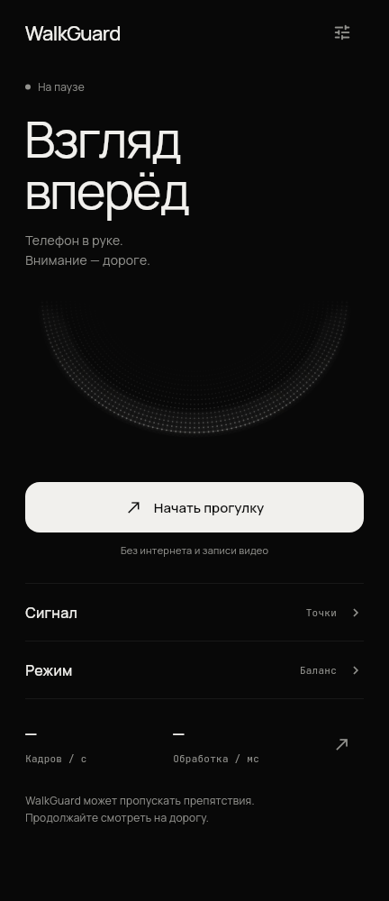
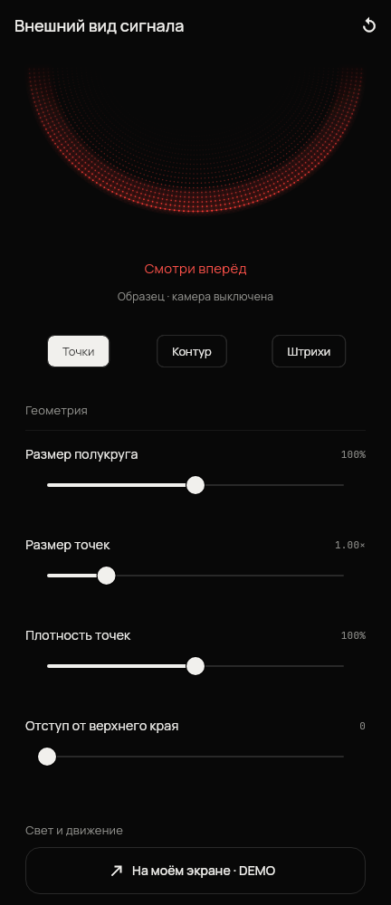
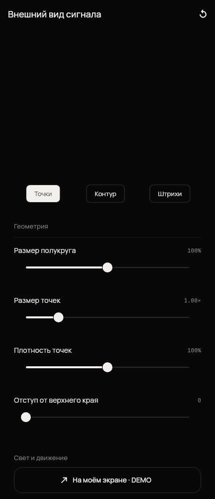

<div align="center">

# WalkGuard

### Phone in hand. Attention ahead.

An offline pedestrian-awareness app for Android.<br>
CameraX · Flutter · Kotlin · On-device inference

[Download APK](https://github.com/crlx1q/WalkGuard/releases/latest) · [На русском](#по-русски) · [Build](#build) · [Model card](docs/MODEL_CARD.md)

</div>

<br>

<table>
<tr>
<td width="33%"></td>
<td width="33%"></td>
<td width="33%"></td>
</tr>
</table>

## A quiet interface. A visible signal.

WalkGuard analyses the rear-camera feed locally. When repeated detections meet the configured criteria, a red dot field appears at the top of the screen. The warning lets touches pass through, so the app underneath stays usable.

The visual system takes cues from dot-matrix hardware: a black canvas, restrained typography and a field of points that grows brighter toward its outer edge. The effect is drawn in Flutter and native Android Canvas. **No SVG artwork, generated pictures or particle assets.**

<p align="center"></p>

*Screenshots and animation are captured from the Flutter UI. They are not photographs of a physical Android device; the signal shown here is a labelled preview.*

## What it does

- **Offline detection.** EfficientDet-Lite0 ships inside the APK; no account or network permission.
- **Explicit camera control.** Start from the app, stop from the app or persistent notification. Locking the screen stops the camera.
- **A warning above other apps.** Native overlay with a camera preview enabled by default during warnings. The preview, text and haptics can be turned off in settings.
- **Your signal.** Dot density, point size, glow, scale, top offset, appearance duration and reduced motion. Contour and dash alternatives are also available.
- **Real diagnostics.** Actual inference timing, frame rate, camera state and thermal status. Missing measurements stay unavailable.
- **First-run guidance.** Three introduction screens, separate permission setup and no automatic camera start.

## Know the limits

This is an experimental attention aid, not a guarantee of obstacle detection or a road-crossing decision system. The bundled COCO model recognises people, vehicles and some other object classes. **Potholes, open manholes, curbs, road edges and steps are not supported.** Poor lighting, phone angle and an obstructed lens can prevent detection. Object size is not distance.

Physical-device validation of background camera behaviour, overlay placement and haptics remains necessary. See the [device test plan](docs/DEVICE_TEST_PLAN.md).

## Install

Download `WalkGuard-debug.apk` from [Releases](https://github.com/crlx1q/WalkGuard/releases/latest). Android 8.0 or newer and a rear camera are required. Allow installation from your file manager, install the APK, then follow the permission setup.

The published package is a universal debug build. It is intended for testing and is larger than an optimised, production-signed release. Version 0.3.1 uses the same development signing certificate as the earlier builds. The camera preview is enabled on upgrade. You can turn it off again in signal settings.

## Build

| Component | Version |
| :-- | :-- |
| Flutter / Dart | 3.50.0 / 3.14.0 |
| Java | 21; JVM target 17 |
| Android | min SDK 26; compile/target SDK 36 |
| Gradle / AGP | 9.5.0 / 9.3.1 |
| NDK | 28.2.13676358 |
| CameraX / LiteRT | 1.6.2 / 1.4.2 |

```sh
git clone https://github.com/crlx1q/WalkGuard.git
cd WalkGuard
flutter pub get
flutter analyze
flutter test
flutter build apk --debug
```

APK: `build/app/outputs/flutter-apk/app-debug.apk`.

```sh
adb install -r build/app/outputs/flutter-apk/app-debug.apk
```

Native checks:

```sh
cd android
./gradlew :app:testDebugUnitTest :app:lintDebug
```

On Linux ARM64, Android's x64 build utilities may need emulation. A standard x64 Linux machine is the simplest build host. The app deliberately omits `INTERNET` in debug builds too; VM Service, hot reload and network-based debugging may be unavailable. A production release needs your own signing configuration.

## Inside

```text
lib/                    Flutter screens, settings and native bridge
android/app/src/main/   Camera service, detector, risk engine and overlay
android/app/src/test/   Native risk, lifecycle, settings and dot-field tests
test/                   Controller, interaction and visual regression tests
assets/                 Fonts and third-party notices
docs/                   Model details, architecture and device test plan
tools/                  Model and APK verification utilities
```

The native pipeline is `CameraX → LiteRT → RiskEvaluator → WarningOverlay`. One inference runs at a time. Frame buffers and the overlay's rendered dot field are reused. Settings persist locally; video is never recorded. [Architecture and rendering](docs/ARCHITECTURE.md).

## По-русски

WalkGuard — помощник для прогулок с телефоном в руке. Он анализирует изображение задней камеры на устройстве и показывает точечный красный сигнал поверх других приложений. Интерфейс приложения — на русском.

[Скачать APK](https://github.com/crlx1q/WalkGuard/releases/latest), пройти знакомство, разрешить камеру, показ поверх приложений и уведомления. Затем отдельно нажать **«Начать прогулку»**. В настройках внешнего вида есть DEMO без запуска камеры.

Приложение может пропускать препятствия и давать ложные тревоги. Оно не распознаёт ямы, люки, бордюры и ступени и не определяет безопасность перехода дороги.

## Credits

EfficientDet-Lite0 and the bundled model metadata are documented in the [model card](docs/MODEL_CARD.md). Manrope and JetBrains Mono retain their bundled OFL notices; other component notices are in `assets/licenses/`. Design review used [unslop by Damir Sokolovsky](https://github.com/heydamir/unslop), CC BY 4.0.

WalkGuard is an independent project and is not affiliated with Nothing Technology.
